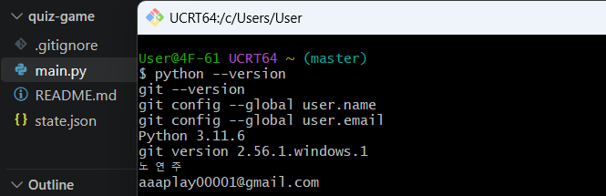
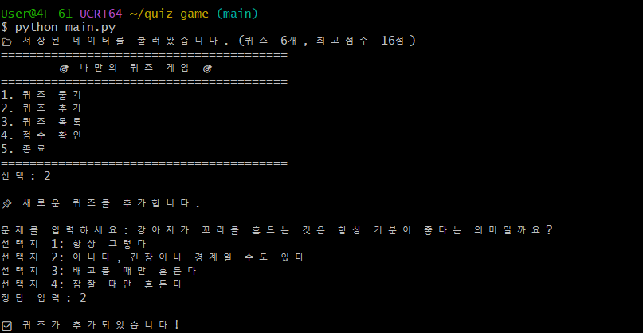
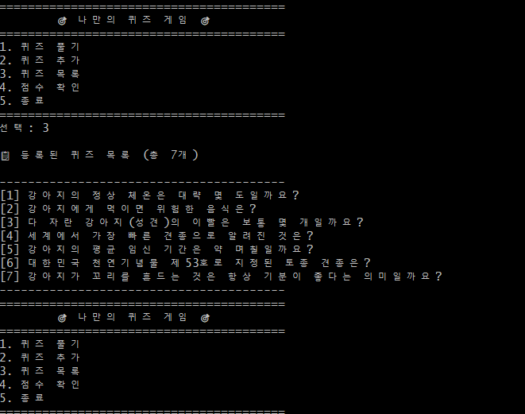
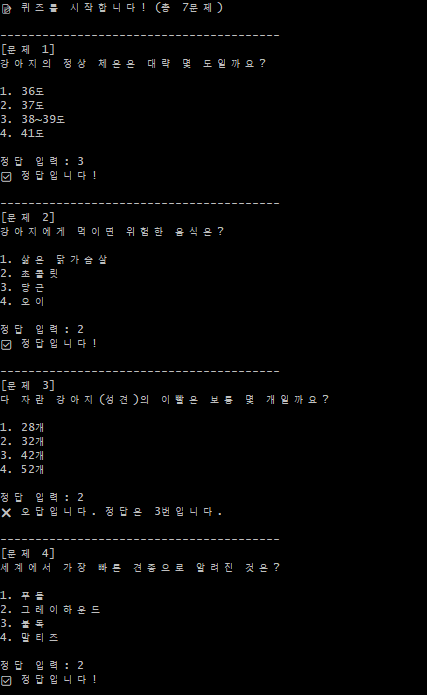
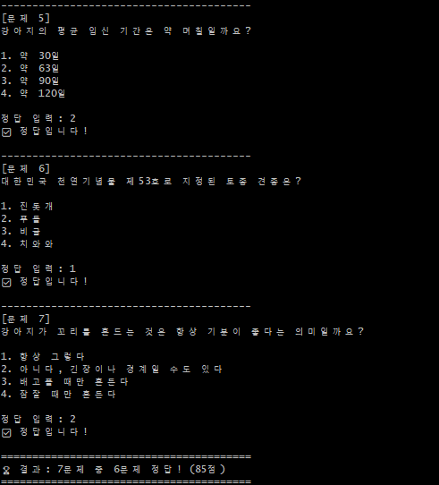
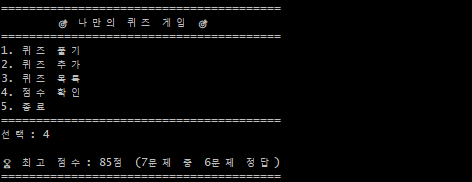
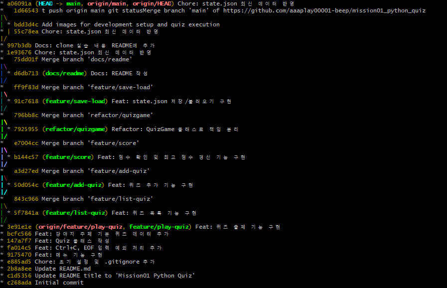

# 🐶 Mission01 Python Quiz

터미널에서 즐기는 **강아지 상식 퀴즈 게임**입니다.
Python 기초 문법, 클래스, JSON 파일 저장, Git/GitHub를 사용해 처음부터 끝까지 직접 만들었습니다.

---

## 📌 프로젝트 개요

- 터미널(검은 화면)에서 실행하는 퀴즈 게임입니다.
- 메뉴에서 번호를 골라 **퀴즈 풀기 / 퀴즈 추가 / 퀴즈 목록 / 점수 확인 / 종료**를 할 수 있습니다.
- 프로그램을 껐다 켜도 **추가한 퀴즈와 최고 점수가 그대로 남아 있습니다.** (`state.json` 파일에 저장)
- 외부 라이브러리 없이 Python 기본 기능만 사용했습니다.

## 🐾 퀴즈 주제 선정 이유

강아지를 좋아해서 주제로 골랐습니다.
강아지의 체온, 먹으면 위험한 음식, 견종 같은 내용은 반려견을 키울 때 실제로 도움이 되는 상식이라, 퀴즈를 풀면서 자연스럽게 배울 수 있다고 생각했습니다.

---

## ▶️ 실행 방법

### 1. 준비물
- Python 3.10 이상 (개발 환경: Python 3.11.6)
- Git

버전 확인 방법 (터미널에 입력):

```bash
python --version
git --version
```

### 2. 내려받기

```bash
git clone https://github.com/aaaplay00001-beep/mission01_python_quiz.git
cd mission01_python_quiz
```

### 3. 실행하기

```bash
python main.py
```

> Mac에서 `python`이 안 되면 `python3 main.py`를 입력하세요.

### 개발 환경 화면

📷 **사진 1** (개발 환경: Python 버전, Git 설정, VSCode)



---

## ✨ 기능 목록

| 메뉴 | 기능 | 설명 |
|---|---|---|
| 1 | 퀴즈 풀기 | 저장된 퀴즈를 차례로 출제하고, 정답/오답을 알려준 뒤 최종 점수를 보여줍니다. |
| 2 | 퀴즈 추가 | 문제, 선택지 4개, 정답 번호를 입력해 나만의 퀴즈를 추가합니다. |
| 3 | 퀴즈 목록 | 등록된 퀴즈의 문제를 번호와 함께 보여줍니다. |
| 4 | 점수 확인 | 지금까지의 최고 점수를 보여줍니다. 퀴즈를 풀 때마다 기록을 비교해 갱신합니다. |
| 5 | 종료 | 데이터를 저장하고 프로그램을 끝냅니다. |

### 그 밖의 기능
- **잘못된 입력 처리**: 빈 입력, 글자(`abc`), 범위 밖 숫자(`9`)를 입력하면 안내 메시지를 보여주고 다시 입력받습니다. 앞뒤 공백(` 1 `)은 자동으로 제거합니다.
- **안전한 종료**: 실행 중 `Ctrl+C`를 누르거나 입력이 끊겨도 에러 없이 데이터를 저장하고 종료합니다.
- **데이터 복구**: `state.json`이 없으면 기본 퀴즈로 시작하고, 파일이 손상되었으면 안내 후 기본 퀴즈로 되돌립니다.

---

## 🎮 사용 방법 (화면 예시)

### 퀴즈 추가 (메뉴 2번)

문제 → 선택지 4개 → 정답 번호 순서로 입력합니다.

📷 **사진 2** (퀴즈 추가 화면)



### 퀴즈 목록 (메뉴 3번)

추가한 퀴즈가 목록 맨 끝에 나타납니다.

📷 **사진 3** (퀴즈 목록 화면)



### 퀴즈 풀기 (메뉴 1번)

문제마다 1~4번 중 정답을 입력합니다. 맞으면 ✅, 틀리면 ❌와 함께 정답을 알려줍니다.

📷 **사진 4** (퀴즈 풀이 화면: 문제 1~4번)



📷 **사진 5** (퀴즈 풀이 화면: 문제 5~7번과 결과)



### 점수 확인 (메뉴 4번)

📷 **사진 6** (점수 확인 화면)



---

## 📁 파일 구조

```
mission01_python_quiz/
├── main.py          # 프로그램 전체 코드 (Quiz, QuizGame 클래스)
├── state.json       # 퀴즈와 최고 점수가 저장되는 파일
├── .gitignore       # Git이 무시할 파일 목록
├── README.md        # 지금 보고 있는 설명서
└── docs/
    └── screenshots/ # 실행 화면 사진
```

## 🧩 코드 구조 (쉽게 설명)

코드는 역할별로 나누어져 있습니다.

### `Quiz` 클래스 — "퀴즈 한 문제"
퀴즈 한 문제를 표현하는 설계도입니다.
- 가지고 있는 값: 문제(`question`), 선택지(`choices`), 정답 번호(`answer`)
- 하는 일: 문제 보여주기(`show`), 정답인지 확인하기(`is_correct`), 파일에 저장하기 좋은 모양으로 바꾸기(`to_dict`, `from_dict`)

### `QuizGame` 클래스 — "게임 전체 관리"
게임 전체를 관리하는 설계도입니다.
- 가지고 있는 값: 퀴즈 목록(`quizzes`), 최고 점수(`best_score`)
- 하는 일: 퀴즈 풀기(`play_quiz`), 퀴즈 추가(`add_quiz`), 목록 보기(`show_quiz_list`), 점수 확인(`show_best_score`), 파일 저장/불러오기(`save_state`, `load_state`), 메뉴 반복 실행(`run`)

### 입력 검사 함수
- `get_menu_choice()`: 메뉴 번호(1~5) 입력을 검사합니다.
- `get_answer_choice()`: 정답 번호(1~4) 입력을 검사합니다.
- `get_nonempty_text()`: 빈 글자 입력을 막습니다.

---

## 💾 데이터 파일 설명 (`state.json`)

| 항목 | 내용 |
|---|---|
| 위치 | 프로젝트 맨 바깥 폴더의 `state.json` |
| 인코딩 | UTF-8 (한글이 깨지지 않도록) |
| 역할 | 퀴즈 목록과 최고 점수를 저장하고, 프로그램을 켤 때 다시 불러옵니다. |
| 파일이 없을 때 | 기본 퀴즈 6개로 시작합니다. |
| 파일이 깨졌을 때 | 안내 메시지를 보여주고 기본 퀴즈로 되돌립니다. |

### 저장 형태 (JSON)

```json
{
    "quizzes": [
        {
            "question": "강아지에게 먹이면 위험한 음식은?",
            "choices": ["삶은 닭가슴살", "초콜릿", "당근", "오이"],
            "answer": 2
        }
    ],
    "best_score": {
        "score": 85,
        "correct": 6,
        "total": 7
    }
}
```

- `quizzes`: 퀴즈 목록입니다. 각 퀴즈는 문제, 선택지 4개, 정답 번호(1~4)를 가집니다.
- `best_score`: 최고 점수입니다. 점수(`score`), 맞힌 개수(`correct`), 전체 문제 수(`total`)가 들어 있습니다. 아직 퀴즈를 풀지 않았다면 `null`입니다.

> **JSON이란?** 데이터를 글자로 적어 두는 약속된 양식입니다. 프로그램이 꺼지면 메모리의 데이터는 사라지지만, 파일에 글자로 적어 두면 다시 켰을 때 읽어서 되살릴 수 있습니다.

---

## 🌿 Git 사용 기록

### 브랜치(가지)를 나눠서 작업했어요
기능 하나를 만들 때마다 새 브랜치에서 작업하고, 완성되면 `main`에 합쳤습니다.

| 브랜치 | 만든 기능 |
|---|---|
| `feature/play-quiz` | 퀴즈 풀기 |
| `feature/list-quiz` | 퀴즈 목록 |
| `feature/add-quiz` | 퀴즈 추가 |
| `feature/score` | 점수 확인 |
| `refactor/quizgame` | QuizGame 클래스로 코드 정리 |
| `feature/save-load` | state.json 저장/불러오기 |
| `docs/readme` | README 작성 |

### 커밋 메시지 규칙
무엇을 했는지 알 수 있도록 앞에 말머리를 붙였습니다.

- `Feat:` 새 기능 (예: `Feat: 퀴즈 출제 기능 구현`)
- `Fix:` 오류 수정
- `Docs:` 문서 작성
- `Refactor:` 코드 정리
- `Chore:` 설정, 기타 작업

### 사용한 Git 명령어

| 명령어 | 하는 일 |
|---|---|
| `git init` | 폴더를 Git이 관리하도록 시작 |
| `git add` | 저장할 파일 고르기 |
| `git commit` | 변경 내용을 설명과 함께 저장 (게임의 세이브) |
| `git push` | 내 컴퓨터의 기록을 GitHub에 올리기 |
| `git pull` | GitHub의 변경을 내 컴퓨터로 가져오기 |
| `git checkout` | 브랜치 만들기/옮겨 다니기 |
| `git merge` | 브랜치를 합치기 |
| `git clone` | GitHub 저장소를 통째로 복제하기 |

### clone / pull 실습
다른 폴더(`quiz-game-clone`)에 저장소를 `clone`하고, README를 수정해서 `push`한 뒤, 원래 폴더에서 `pull`로 변경 사항을 가져와 반영되는 것을 확인했습니다.

### 커밋 수 증빙
총 **32개**의 커밋을 만들었습니다. (과제 기준: 10개 이상)

```bash
git rev-list --count HEAD
```

대표 커밋 로그 (`git log --oneline` 일부):

```
Feat: 메뉴 기능 구현
Feat: Quiz 클래스 작성
Feat: 강아지 주제 기본 퀴즈 데이터 추가
Feat: 퀴즈 출제 기능 구현
Feat: 퀴즈 목록 기능 구현
Feat: 퀴즈 추가 기능 구현
Feat: 점수 확인 및 최고 점수 갱신 기능 구현
Refactor: QuizGame 클래스로 책임 분리
Feat: state.json 저장/불러오기 구현
Docs: README 작성
```

### 병합 방식과 충돌 사례
- `git merge --no-ff`로 병합해서 "어느 브랜치를 합쳤는지"가 그래프에 남도록 했습니다. (rebase는 사용하지 않았습니다.)
- 충돌 사례: 같은 `state.json`을 두 폴더(`quiz-game`, `quiz-game-clone`)에서 따로 바꿔 push하자 `rejected` 오류가 났습니다. `git pull --no-rebase origin main`으로 먼저 합친 뒤 다시 push해서 해결했습니다.

### Git 그래프

가지가 갈라졌다가 합쳐지는 모양으로 브랜치 작업 기록을 볼 수 있습니다.
(`git log --oneline --graph` 결과)

📷 **사진 7** (Git 그래프)



---

## 🆚 왜 함수 대신 클래스를 썼을까?

| 구분 | 함수만 사용 | 클래스 사용 (이 프로젝트) |
|---|---|---|
| 데이터 관리 | `quizzes`, `best_score`를 함수끼리 계속 주고받아야 함 | `QuizGame`이 `self.quizzes`, `self.best_score`로 한곳에서 관리 |
| 코드 찾기 | 함수가 많아지면 어느 게 어느 기능인지 헷갈림 | 퀴즈 관련은 `Quiz`, 게임 전체는 `QuizGame`으로 묶임 |
| 확장 | 퀴즈에 힌트를 추가하면 여러 함수를 다 고쳐야 함 | `Quiz` 클래스만 고치면 됨 |

실제로 처음에는 함수로 만들었다가, 값을 주고받는 코드가 복잡해져서 `QuizGame` 클래스로 정리(Refactor)했습니다.
단점은 처음 배울 때 `self`와 `__init__` 개념이 어렵다는 점입니다.

## 🏗️ 클래스 호출 흐름과 설계 이유

```
run() → QuizGame() 생성 → load_state()로 파일 읽기
      → game.run() 메뉴 반복
          ├ 1번 → play_quiz() → Quiz.show(), Quiz.is_correct()
          ├ 2번 → add_quiz() → Quiz 만들기 → save_state()
          └ 5번 → save_state() 후 종료
```

- **입력 검사**(`get_menu_choice` 등)와 **파일 저장/불러오기**(`save_state`, `load_state`)를 나눈 이유: 한 함수는 한 가지 일만 하도록(단일 책임 원칙) 해서, 문제가 생기면 어디를 고칠지 바로 알 수 있게 하기 위해서입니다.
- **`best_score`를 딕셔너리로 중첩한 이유**: 점수만 저장하면 "몇 문제 중 몇 개"를 알 수 없고, 나중에 날짜 같은 항목을 추가하기 쉽습니다.

## ⚠️ 한계와 개선 아이디어

- **JSON 저장의 한계**: 퀴즈가 수만 개로 많아지면 매번 파일 전체를 읽고 써서 느려지고 메모리를 많이 씁니다. 대규모 데이터에는 SQLite 같은 데이터베이스가 더 적합합니다.
- **백업 없음**: 파일이 손상되면 기본 퀴즈로 초기화되어 이전 데이터를 복구할 수 없습니다. 개선 방법: 손상 시 원본을 `state.json.bak`으로 보존하기.
- **동시 실행/쓰기 중단**: 프로그램을 두 개 동시에 실행하거나 저장 중 꺼지면 파일이 깨질 수 있습니다. 개선 방법: 임시 파일에 쓴 뒤 교체하기.
- **인코딩**: 한글이 깨지지 않도록 `encoding="utf-8"`로 저장하고, `ensure_ascii=False`로 한글을 `\uXXXX` 대신 그대로 적습니다.

## 🔧 요구사항이 바뀌면 어디를 고치나? (수정 지점)

| 바꾸고 싶은 것 | 수정할 파일 | 수정할 곳 |
|---|---|---|
| 기본 퀴즈 내용 | `main.py` | `create_default_quizzes()` |
| 퀴즈에 힌트 추가 | `main.py` | `Quiz.__init__`, `show`, `to_dict`, `from_dict` |
| 저장 항목 추가 (예: 점수 기록) | `main.py` | `save_state()`, `load_state()` |
| 메뉴 추가 | `main.py` | `show_menu()`, `get_menu_choice()`, `QuizGame.run()` |
| 점수 계산 방식 | `main.py` | `QuizGame.play_quiz()` |
| 저장 파일 이름 | `main.py` | `STATE_FILE` |

## 📚 배운 점

- 변수, 리스트, 딕셔너리, 조건문, 반복문, 함수를 직접 써서 하나의 프로그램을 완성했습니다.
- 클래스로 코드를 역할별로 나누면 읽기 쉽고 고치기 쉽다는 것을 알았습니다.
- JSON 파일로 데이터를 저장하면 프로그램을 꺼도 데이터가 유지됩니다.
- `try/except`로 오류가 나도 프로그램이 멈추지 않게 만들 수 있습니다.
- Git으로 작업 기록을 남기고, 브랜치로 안전하게 기능을 추가하는 방법을 익혔습니다.